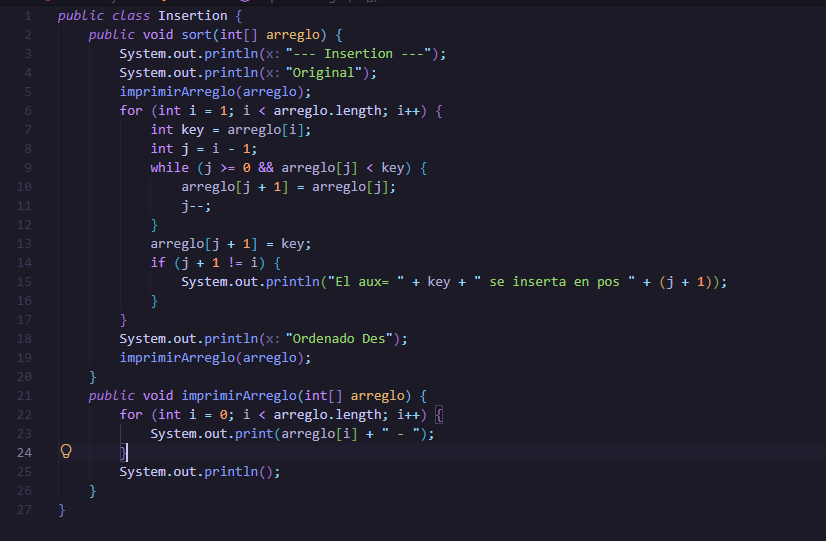
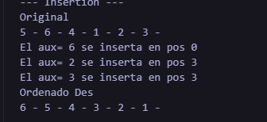

## PC 1.1.3
## Metodo Insertionss

## Explicacion
# El for toma cada número desde el segundo elemento y lo guarda en aux. El while compara ese valor hacia atrás, desplaza a la derecha todos los elementos menores y abre un espacio para insertar la aux en su posición final, imprimiendo el mensaje solo cuando hubo un movimiento.
## Resultado
